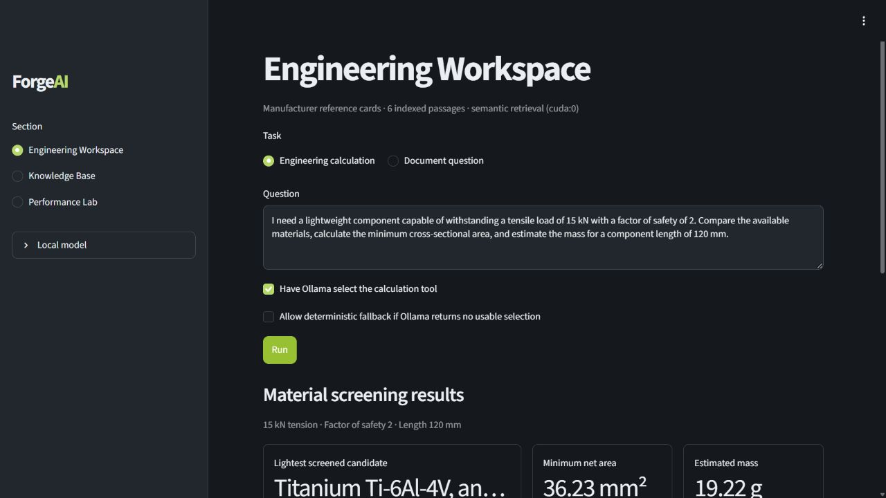
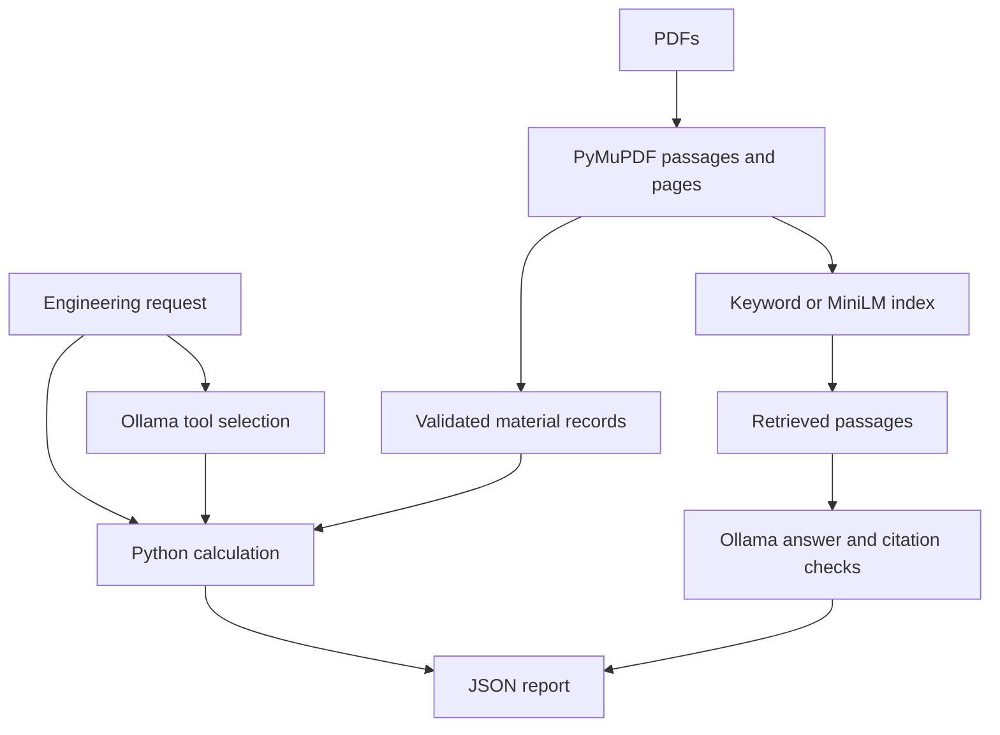

# ForgeAI

ForgeAI is a local engineering workstation for preliminary material screening. Upload technical PDFs, ask a question with page-level evidence, or run a material comparison that exports its inputs, calculations and sources. Performance Lab measures the embedding and inference stack on the same workstation.



## Launch

Start Ollama with `qwen3:4b` available. From the repository root in PowerShell, use the existing environment.

```powershell
.\.venv\Scripts\python.exe -m streamlit run app.py --server.address 127.0.0.1 --server.port 8502 --server.headless true
```

Open [ForgeAI on port 8502](http://localhost:8502). Restart Streamlit after a source update so the process imports the current modules.

For a first-time Windows x64 setup, install Python 3.14, a driver compatible with CUDA 12.8 and [Ollama](https://ollama.com/download/windows). Start Ollama and run the bootstrap below. It installs dependencies and caches the models. Use the launch command above afterward.

```powershell
.\scripts\bootstrap.ps1 -WithOllama
.\.venv\Scripts\python.exe -m pip install -r requirements-ui.txt
```

## Try the flagship workflow

1. In **Engineering Workspace**, choose **Semantic on CUDA** and select **Load manufacturer demo**.
2. Run the prefilled 15 kN question with **Have Ollama select the calculation tool** enabled. Open **Agent execution trace** to see the selection method and normalized inputs.
3. Open **Property evidence** to inspect the manufacturer references, then use **Download report JSON** to export the calculation.
4. In **Knowledge Base**, upload a PDF or inspect the example passages. In **Performance Lab**, inspect the saved laptop runs or run a local experiment.

The demo compares a uniform 120 mm part under 15 kN of static axial tension with a safety factor of 2. Qwen3 selects an allowlisted calculation using a JSON schema. Python validates the request and units, computes net area as safety factor × force ÷ tensile yield, and ranks the candidates by estimated mass.

| Candidate | Yield basis and density | Minimum net area (mm²) | Mass per length (kg/m) | Mass at 120 mm (g) |
|---|---|---:|---:|---:|
| Annealed Ti-6Al-4V, ASTM B348 stock under 3 in, longitudinal | 828 MPa minimum, 4,420 kg/m³ | 36.23 | 0.1601 | 19.22 |
| 7075-T6 rod/bar | 503 MPa typical, 2,800 kg/m³ | 59.64 | 0.1670 | 20.04 |
| 6061-T6 rod/bar | 276 MPa typical, 2,700 kg/m³ | 108.70 | 0.2935 | 35.22 |

ForgeAI generates original reference PDFs for the demo and links to the corresponding pages in the manufacturer datasheets. The listed yield and density appear on pages 1 and 2 of both Kaiser sheets, and pages 2 and 1 of the TIMET sheet. [Kaiser 6061](https://online.kaiseraluminum.com/depot/PublicProductInformation/Document/1025/Kaiser_Aluminum_6061_Rod_and_Bar.pdf) · [Kaiser 7075](https://online.kaiseraluminum.com/depot/PublicProductInformation/Document/1028/Kaiser_Aluminum_7075_Rod_and_Bar.pdf) · [TIMET Ti-6Al-4V](https://www.timet.com/documents/datasheets/alpha-and-beta-alloys/timetal-6-4.pdf)

```powershell
.\.venv\Scripts\python.exe -m forgeai flagship --retrieval cuda --model qwen3:4b --output experiments/raw_results/flagship.json
.\.venv\Scripts\python.exe -m forgeai reference-pdfs
.\.venv\Scripts\python.exe -m forgeai demo --through-pdf --length-mm 120
```

## Architecture



The Python and Streamlit app uses PyMuPDF, NumPy, Sentence Transformers, CUDA-enabled PyTorch, Ollama, Altair and NVIDIA-SMI. Documents and model inference stay on the workstation after the initial model downloads.

## Laptop results

| Embedding batch | CPU texts/s | CUDA texts/s | CUDA speedup | Maximum absolute difference |
|---:|---:|---:|---:|---:|
| 1 | 63.37 | 84.87 | 1.34× | 1.90e-7 |
| 8 | 145.12 | 627.73 | 4.33× | 1.90e-7 |
| 32 | 173.62 | 1,497.98 | 8.63× | 1.98e-7 |

The RTX 5070 Laptop GPU passed embedding parity at all three batch sizes. Three capped Qwen3:4b trials averaged **41.59 output tokens/s**, with GPU placement reported in each trial. The saved data describes one laptop and workload. [Benchmark method](docs/benchmarking.md) · [Raw measurements](experiments/published/) · [Validation record](docs/validation.md)

## Limits

- The calculator assumes ductile material and static axial loading through a uniform net area. Connections, stress concentrations, fatigue and environmental effects require separate analysis. Review supplier specifications and allowable properties for design work.
- The calculation tools expect explicit yield and density records. Generic text PDFs support search and citations. Scanned pages and irregular tables may require preprocessing.
- Citation checks validate the quote and page. Answer relevance can vary. In the six-query test, CUDA semantic retrieval found the expected source in the top three for 4/6 queries and keyword retrieval for 5/6.
- The benchmark is a single-machine comparison with short trials and a fixed device order. Further evaluation should rotate the device order and expand the document and query corpus.

[Architecture details](docs/architecture.md) · [Product one-pager](docs/product-one-pager.md) · [Demo script](docs/demo-script.md)
