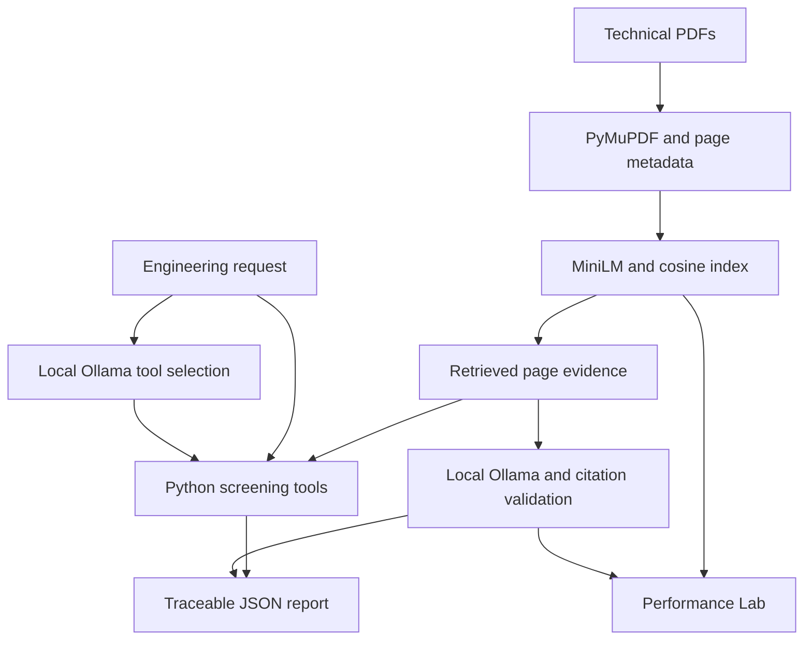

# ForgeAI

ForgeAI is a local engineering workstation for early material screening. A manufacturing engineer can upload technical PDFs, ask a question, inspect the exact page evidence, and export a report with the inputs, calculations and assumptions. Performance Lab measures the same embedding and inference stack used by the workspace.

## Try the flagship workflow

Open [ForgeAI on localhost](http://127.0.0.1:8501), load the manufacturer demo using **Semantic on CUDA**, and run the prefilled 15 kN question. Keep Ollama selection enabled to see the local model choose the calculator. The automated path below produces the same structured report:

```powershell
.\.venv\Scripts\python.exe -m forgeai flagship --retrieval cuda --model qwen3:4b --output experiments/raw_results/flagship.json
```

The comparison sizes a uniform 120 mm part for static axial tension with a safety factor of 2. The three data cards are original ForgeAI summaries. Their numerical inputs come from the original manufacturer PDFs. The synthetic fixture remains available in Knowledge Base and through `python -m forgeai demo`.

| Stock | Yield basis | Yield | Density | Original yield / density pages |
|---|---|---:|---:|---|
| Aluminum 6061-T6 rod/bar | Typical | 276 MPa | 2,700 kg/m³ | [Kaiser Aluminum, pp. 1 and 2](https://online.kaiseraluminum.com/depot/PublicProductInformation/Document/1025/Kaiser_Aluminum_6061_Rod_and_Bar.pdf) |
| Aluminum 7075-T6 rod/bar | Typical | 503 MPa | 2,800 kg/m³ | [Kaiser Aluminum, pp. 1 and 2](https://online.kaiseraluminum.com/depot/PublicProductInformation/Document/1028/Kaiser_Aluminum_7075_Rod_and_Bar.pdf) |
| Annealed Ti-6Al-4V, ASTM B348 stock, longitudinal | Minimum 0.2% offset | 828 MPa | 4,420 kg/m³ | [TIMET, pp. 2 and 1](https://www.timet.com/documents/datasheets/alpha-and-beta-alloys/timetal-6-4.pdf) |

## Architecture



**Stack** Python 3.14, Streamlit, Altair, PyMuPDF, NumPy, PyTorch CUDA 12.8, Sentence Transformers MiniLM, Ollama Qwen3:4b, and NVIDIA-SMI.

## Setup and launch

On Windows x64, install Python 3.14, an NVIDIA driver compatible with CUDA 12.8, and [Ollama](https://ollama.com/download/windows). Start the Ollama service. Then run from the repository root in PowerShell.

```powershell
.\scripts\bootstrap.ps1 -WithOllama
.\.venv\Scripts\python.exe -m pip install -r requirements-ui.txt
.\.venv\Scripts\python.exe -m streamlit run app.py --server.address 127.0.0.1 --server.headless true
```

The first bootstrap downloads the embedding model and Qwen3. Subsequent document processing uses the cached model and the local Ollama endpoint. To generate actual PDF files for upload, run `python -m forgeai reference-pdfs` with the project Python. The third-party PDFs are linked from their original publishers.

## Laptop results

| Embedding batch | CUDA speedup | Maximum absolute difference |
|---:|---:|---:|
| 1 | 1.34× | 1.90e-7 |
| 8 | 4.33× | 1.90e-7 |
| 32 | 8.63× | 1.98e-7 |

Recorded on a Ryzen AI 7 350 and RTX 5070 Laptop GPU with driver 576.76 and PyTorch 2.11.0+cu128. Both devices processed the same 72 fixed synthetic snippets in float32, with one warmup and three timed trials per configuration. CUDA was synchronized at both timer boundaries. All three configurations passed numerical parity. The three capped Ollama trials averaged **41.59 output tokens/s** with GPU placement reported in every trial. A live replay returned the finish reason `length`, so the original capped trials are throughput measurements.

See the [benchmark method](docs/benchmarking.md) and [audited trial data](experiments/published/). Diagnostic temperature, power and memory snapshots describe the hardware at collection time.

## Limits and next steps

- Screening assumes uniform, ductile, static axial loading. It omits joints, stress concentration, fatigue, and environmental derating. The results use typical aluminum yield and a condition-specific minimum titanium yield. Design approval requires applicable material specifications and allowables.
- The comparison calculator reads explicit, unambiguous yield and density records. Generic text PDFs support search and citation. Irregular tables and scans require extraction review or preprocessing.
- Citation checks verify exact quoted text and page provenance. The six-query retrieval evaluation is a small reference-card check, so broader retrieval and paraphrase quality need a larger held-out corpus.
- The performance tests concern one laptop, model and workload. Future work includes order-controlled replications and expanded quality evaluations.

[Validation record](docs/validation.md) · [Architecture details](docs/architecture.md) · [Product one-pager](docs/product-one-pager.md) · [Demo script](docs/demo-script.md)
